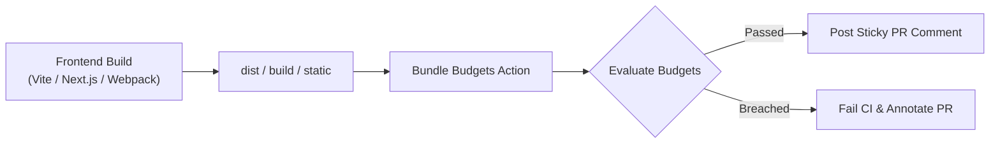

# Bundle Budgets Action 📦⚡

[](https://github.com/pdbhat/bundle-budgets-action/actions/workflows/ci.yml)
[](LICENSE)
[](https://github.com/pdbhat/bundle-budgets-action/pulls)

A fast, zero-dependency GitHub Action & CLI to enforce asset budgets, track bundle sizes across Raw, Gzip, and Brotli compression, and guard Web Vitals (LCP, TBT) directly in CI pull requests.

---

## 🎯 Motivation

Frontend applications easily suffer from bundle bloat when dependencies creep in unnoticed. Traditional bundle size tools either require complex third-party SaaS dashboards, slow down CI, or don't support modern Brotli metrics.

**Bundle Budgets Action** provides:
- 🚀 **Zero External Services**: Runs directly in your GitHub Actions runner with zero external token dependencies.
- 🗜️ **Comprehensive Compression Metrics**: Accurately computes **Raw**, **Gzip**, and **Brotli** byte sizes for every matched asset.
- 💬 **Sticky PR Commenting**: Posts or updates an insightful, readable markdown summary table on incoming Pull Requests.
- 🚦 **Configurable Threshold Enforcement**: Fails the CI pipeline when configured raw, gzip, or brotli limits are exceeded.

---

## 🏗️ Architecture



---

## 🚀 Quick Start (GitHub Action)

Add `bundle-budgets-action` to your `.github/workflows/ci.yml` after your build step:

```yaml
name: CI & Performance Guard

on:
  pull_request:
    branches: [main]

jobs:
  build-and-audit:
    runs-on: ubuntu-latest
    permissions:
      contents: read
      pull-requests: write # Required for posting PR comments
    steps:
      - uses: actions/checkout@v4

      - name: Setup Node
        uses: actions/setup-node@v4
        with:
          node-version: 22

      - name: Install & Build
        run: |
          npm ci
          npm run build

      - name: Evaluate Bundle Budgets
        uses: pdbhat/bundle-budgets-action@v1
        with:
          directory: 'dist'
          config-file: '.bundle-budgetrc.json'
          fail-on-breach: 'true'
          comment-on-pr: 'true'
          github-token: ${{ secrets.GITHUB_TOKEN }}
```

---

## ⚙️ Configuration (`.bundle-budgetrc.json`)

Place a `.bundle-budgetrc.json` at the root of your project:

```json
{
  "directory": "dist",
  "budgets": [
    {
      "pathPattern": "**/*.js",
      "maxGzipSize": "250KB",
      "maxBrotliSize": "200KB"
    },
    {
      "pathPattern": "**/*.css",
      "maxGzipSize": "40KB"
    },
    {
      "pathPattern": "assets/vendor-*.js",
      "maxRawSize": "600KB",
      "maxBrotliSize": "150KB"
    }
  ]
}
```

### Supported Size Units
Sizes can be written with human-readable suffixes:
- `B` (Bytes, e.g. `500B`)
- `KB` (Kilobytes, e.g. `150KB` or `1.5KB`)
- `MB` (Megabytes, e.g. `1.2MB`)

---

## 💻 CLI Usage

You can also run the evaluation locally before pushing:

```bash
npx bundle-budgets --dir dist --config .bundle-budgetrc.json
```

---

## 📊 Sample Pull Request Output

| Pattern | Files | Raw Size | Gzip Size | Brotli Size | Status |
| :--- | :---: | :---: | :---: | :---: | :---: |
| `**/*.js` | 12 | 845.20 KB<br><sub>max 1.5MB</sub> | 210.45 KB<br><sub>max 250KB</sub> | 178.10 KB<br><sub>max 200KB</sub> | ✅ Pass |
| `**/*.css` | 3 | 42.10 KB | 12.30 KB<br><sub>max 40KB</sub> | 9.80 KB | ✅ Pass |

---

## 🤝 Contributing & Community

Contributions and feature requests are welcome!
- Check out [Discussions](https://github.com/pdbhat/bundle-budgets-action/discussions) to ask questions, share architecture proposals, or propose new metrics.
- Submit bug reports and feature requests via [Issues](https://github.com/pdbhat/bundle-budgets-action/issues).

## 📄 License

[MIT](LICENSE) © [Priyadarshan Bhat](https://github.com/pdbhat)
